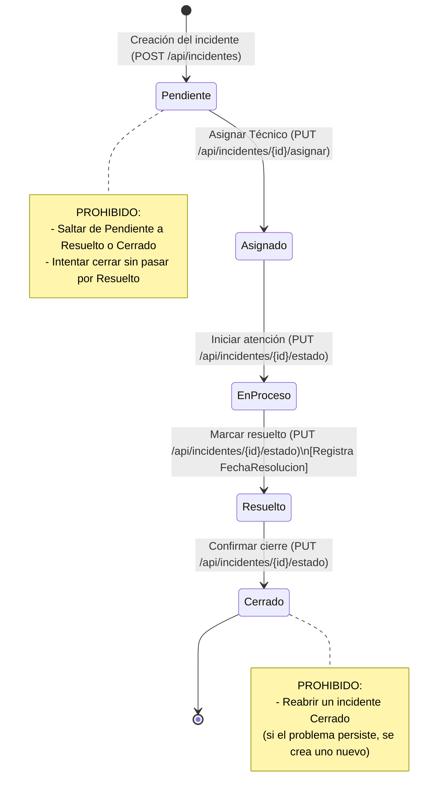

# Hoja de Análisis: TechSupport Solutions API

## Bloque A · Análisis

### A1. Del problema al requerimiento
Alineación entre los problemas detectados por la gerencia de TechSupport Solutions, la solución técnica implementada en la Web API y su criterio de verificación.

| # | Problema detectado | Requerimiento (Funcionalidad que lo resuelve) | Prueba de que se resolvió |
|---|---|---|---|
| 1 | **Las solicitudes se pierden** entre cientos de mensajes en canales dispersos (WhatsApp, correos, llamadas). | Centralización de incidentes mediante una Web API con persistencia relacional en SQLite y endpoint de creación estandarizado (`POST /api/incidentes`). | Al enviar un `POST /api/incidentes`, el sistema retorna código `201 Created` con el ID asignado y el incidente queda registrado de forma persistente en la base de datos con estado inicial `Pendiente`. |
| 2 | **Asignaciones poco claras** (dos técnicos atienden lo mismo o incidentes quedan desatendidos). | Endpoint restringido para administradores (`PUT /api/incidentes/{id}/asignar`) con validación estricta de que el usuario asignado tenga exclusivamente el rol `Técnico`, avanzando automáticamente el estado a `Asignado`. | Al asignar un técnico válido, el campo `TecnicoId` se actualiza y el estado cambia a `Asignado`. Si se intenta asignar a un usuario con rol distinto a `Técnico`, la API responde `400 Bad Request`. |
| 3 | **Se consulta información ajena** (empleados visualizan incidentes confidenciales de otros clientes o áreas). | Control de acceso basado en propiedad y roles (RBAC/ABAC). El ID del solicitante se obtiene del JWT (claims), no de la petición. El técnico solo consulta los asignados a él; el usuario solo los que él creó; el administrador tiene visibilidad total. | Petición con token de Usuario A intentando consultar el detalle de un incidente creado por Usuario B retorna `404 Not Found`. Listados (`GET /api/incidentes`) aplican filtros automáticos según el solicitante. |
| 4 | **Errores sin registro / con detalles internos** (fugas de información sensible del servidor o base de datos ante excepciones no controladas). | Middleware centralizado de manejo de excepciones (`ExceptionHandlingMiddleware`) al inicio del pipeline HTTP que intercepta fallos, los registra en logs mediante `ILogger` y devuelve una respuesta segura estándar (`500 Internal Server Error`) con un identificador de rastreo (`requestId`). | Endpoint de prueba con excepción inducida responde con formato JSON seguro `{ success: false, message, requestId, timestamp }`, sin traza de pila (stack trace), nombres de tablas o rutas internas. |

---

### A2. Diagrama de Estados del Incidente

El ciclo de vida del incidente es estrictamente secuencial y unidireccional. No se permite saltar fases intermedias ni reabrir incidentes cerrados.

---

### A3. Decisiones de Diseño y Justificación

#### 1. ¿Cuando alguien consulta un incidente que no es suyo, respondes 403 o 404? ¿Qué ventaja de seguridad tiene el 404?
* **Decisión adoptada**: Se responde **`404 Not Found`**.
* **Justificación de seguridad**: Responder `403 Forbidden` confirma la existencia del recurso en el sistema (revelando que el ID consultado existe pero no se tienen permisos), lo que facilita ataques de **enumeración de recursos** e inferencia de información confidencial. Al responder `404 Not Found`, un atacante externo o usuario malintencionado no puede distinguir entre un incidente que no existe y uno que existe pero no le corresponde.

#### 2. ¿Puede un administrador eliminar un incidente que ya está Cerrado? ¿Qué se pierde si lo hace?
* **Decisión adoptada**: **No se debe permitir eliminar incidentes cerrados** (o debe restringirse a borrado lógico con fines de cumplimiento).
* **Justificación de seguridad y negocio**: Si un incidente cerrado se elimina físicamente de la base de datos, se pierde la **trazabilidad histórica y la evidencia de auditoría** (quién reportó, qué técnico atendió, tiempos de resolución SLA y precedentes para futuros problemas similares). La información histórica de incidentes es vital para métricas de calidad y rendición de cuentas.

